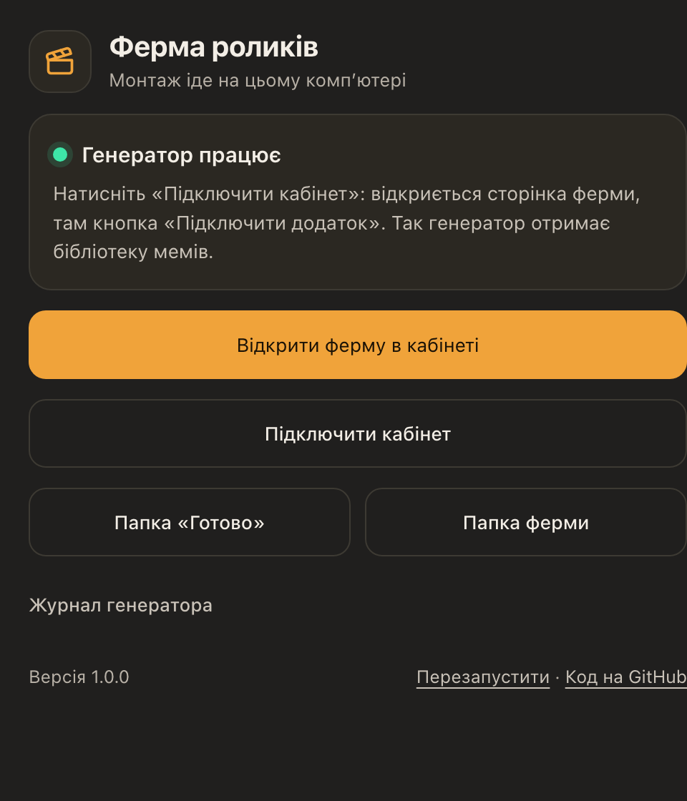

# Video farm · tyne.pro

**UA.** Програма для інструмента «Ферма роликів» у кабінеті [tyne.pro](https://tyne.pro): монтує короткі ролики для TikTok, Reels і Shorts на вашому комп’ютері. Працює разом із кабінетом. Код відкритий, щоб кожен міг прочитати його до встановлення.

- Монтаж іде на вашому комп’ютері. Відео нікуди не завантажуються.
- Програма слухає лише цей комп’ютер (127.0.0.1:4747).
- Усередині вже є Node.js, ffmpeg і генератор. Перелік бібліотек і їхні ліцензії — у NOTICE.txt усередині програми.
- Версія генератора **a79b5f5606aa**. Результат перевірки VirusTotal показано на сторінці інструмента.

### Mac (Apple Silicon)

Однією командою в «Терміналі»:

```
curl -fsSL https://raw.githubusercontent.com/tyne-pro/video-farm/main/install.sh | bash
```

### Windows 10 і 11 (x64)

Однією командою в PowerShell:

```
irm https://raw.githubusercontent.com/tyne-pro/video-farm/main/install.ps1 | iex
```

Або завантажте `*-setup.exe` з розділу Releases. Установник без цифрового підпису, тому Windows може показати вікно SmartScreen: натисніть «Докладніше», потім «Однаково запустити».

У папці `app` — сама програма (Tauri). Установники для Mac і Windows збирає GitHub Actions цього репозиторію: збирає, ставить на чистий Windows, запускає й робить пробний ролик, потім публікує в Releases.




**EN.** The app behind the "Video farm" tool in the [tyne.pro](https://tyne.pro) cabinet: it edits short clips for TikTok, Reels and Shorts on your computer. It works together with the cabinet. The source is open so anyone can read it before installing.

- Editing runs on your computer. Videos are not uploaded anywhere.
- The app listens only on this computer (127.0.0.1:4747).
- It already carries Node.js, ffmpeg and the generator. The libraries and their licences are listed in NOTICE.txt inside the app.
- Generator version **a79b5f5606aa**. The VirusTotal result is shown on the tool page.

### Mac (Apple Silicon)

```
curl -fsSL https://raw.githubusercontent.com/tyne-pro/video-farm/main/install.sh | bash
```

### Windows 10 and 11 (x64)

```
irm https://raw.githubusercontent.com/tyne-pro/video-farm/main/install.ps1 | iex
```

Or download `*-setup.exe` from Releases. The installer is not signed, so Windows may show SmartScreen: press "More info", then "Run anyway".

The `app` folder holds the app itself (Tauri). This repository's GitHub Actions build the Mac and Windows installers, install the Windows one on a clean machine, start it and make a test clip, then publish them under Releases.
