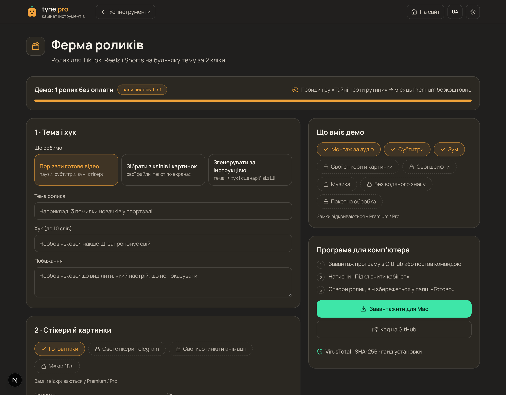

# Video farm · tyne.pro

**UA.** Генератор коротких роликів для інструмента «Ферма роликів» у кабінеті [tyne.pro](https://tyne.pro). Працює тільки разом із кабінетом: команду встановлення видає сторінка інструмента. Код відкритий, щоб кожен міг прочитати його до встановлення.

- Монтаж іде на вашому комп’ютері. Відео нікуди не завантажуються.
- Генератор слухає лише цей комп’ютер (127.0.0.1:4747).
- Ставить офіційні пакети: Node.js, ffmpeg, Git, Remotion, whisper.cpp, Claude Code.
- Версія генератора **b55c44c62f0c**. Результат перевірки VirusTotal показано на сторінці інструмента в кабінеті.

### Додаток для Mac

Встановлення на Mac (Apple Silicon) однією командою в «Терміналі»:

```
curl -fsSL https://raw.githubusercontent.com/tyne-pro/video-farm/main/install.sh | bash
```

У папці `app` — додаток на Rust (Tauri). Усередині вже є Node.js, ffmpeg і генератор, тож нічого не треба вводити в терміналі. Установники збирає GitHub Actions цього репозиторію й публікує в розділі Releases.




**EN.** The clip generator behind the "Video farm" tool in the [tyne.pro](https://tyne.pro) cabinet. It works only together with the cabinet: the tool page gives the install command. The source is open so anyone can read it before installing.

- Editing runs on your computer. Videos are not uploaded anywhere.
- The generator listens only on this computer (127.0.0.1:4747).
- Installs official packages: Node.js, ffmpeg, Git, Remotion, whisper.cpp, Claude Code.
- Generator version **b55c44c62f0c**. The VirusTotal result is shown on the tool page in the cabinet.

### Mac app

Install on a Mac (Apple Silicon) with one Terminal command:

```
curl -fsSL https://raw.githubusercontent.com/tyne-pro/video-farm/main/install.sh | bash
```

The `app` folder holds a Rust (Tauri) app. It already carries Node.js, ffmpeg and the generator, so nothing has to be typed in a terminal. This repository's GitHub Actions build the installers and publish them under Releases.
